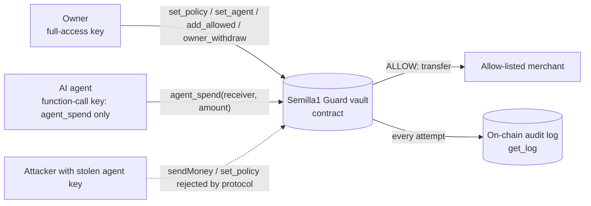

# Semilla1 Guard

**An on-chain spending-limit vault for AI agents on NEAR.**
Give an AI agent money without giving it the keys to everything.

> **TL;DR**
> 1. A NEAR contract holds the money; the AI agent only gets a function-call key for `agent_spend`.
> 2. The contract enforces per-tx cap, rolling 24h cap, receiver allow-list and cooldown; worst case loss = `daily_cap`.
> 3. Live on testnet with 6 verifiable ALLOW/DENY txs; `bash testnet/verify.sh` checks them with only `curl` + `python3`.

## What it does (in one paragraph)
Semilla1 Guard is a NEAR smart contract that holds funds on behalf of an owner and lets an
AI agent spend them **only within rules enforced by the contract itself**: a per-transaction
cap, a rolling 24-hour cap, an allow-list of receivers, and a cooldown between spends. The
agent never holds a full-access key — it gets a NEAR **function-call access key** scoped to a
single method (`agent_spend`) on the vault. Every spend attempt, allowed or denied, emits a NEP-297
event, and every attempt by the agent is written to an on-chain audit log.

## The security guarantee
If the agent or its key is fully compromised, the attacker **cannot**:
1. Spend more than `per_tx_cap` in one transaction.
2. Spend more than `daily_cap` in any rolling 24h window.
3. Pay any receiver not on the owner's allow-list.
4. Spend faster than `cooldown`.
5. Transfer NEAR directly (function-call keys cannot attach deposits — enforced by the protocol).

**Maximum possible loss = `daily_cap`.** Each guarantee maps to a named test (see below).

## For judges (human or AI): verify in 2 minutes
**Live on NEAR testnet** — contract `vault.semilla1guard-1792872425535.testnet`
([explorer](https://testnet.nearblocks.io/address/vault.semilla1guard-1792872425535.testnet)).
Every guarantee below was exercised on-chain:

| Attempt | Result | Tx |
|---|---|---|
| Agent pays allow-listed merchant 0.1 NEAR | ALLOW | [Ht1aft7r…](https://testnet.nearblocks.io/txns/Ht1aft7ryQMD8SZx5gykTER11ebF9sy3a5xuuTcJHSGs) |
| Agent pays attacker (not on allow-list) | DENY | [ATysBMEH…](https://testnet.nearblocks.io/txns/ATysBMEH9iCCeBxP2JksqcGt9AghuJFHAmgNQn8Duqj7) |
| Spend over `per_tx_cap` | DENY | [BjYmWVuz…](https://testnet.nearblocks.io/txns/BjYmWVuzhDpcUYPdzUY527TU9RFAQH9Vs8Ncv9XVyp1W) |
| Caller is not the agent | DENY | [8hcMXQAN…](https://testnet.nearblocks.io/txns/8hcMXQANFDnCsMbEyEfzwLHyvXDrwRHxdnP2FzUsbwwe) |
| Spend over rolling `daily_cap` | DENY | [GCdA74Uv…](https://testnet.nearblocks.io/txns/GCdA74UvrLNienA6bTbRDemnRY5S1zvgwo2MbtAbmTnZ) |
| Function-call key tries `agent_spend` with cap exhausted | returns `false` | [7pdqi5dr…](https://testnet.nearblocks.io/txns/7pdqi5drkidHVjY9gMzQSJcKFRQUXtHZgCNBvHYzwSeD) |

With the agent's function-call key, `sendMoney` fails with `RequiresFullAccess` and `set_policy`
fails with `MethodNameMismatch`: a stolen agent key can only call `agent_spend`, inside the caps.
**No explorer needed:** `bash testnet/verify.sh` (only `curl` + `python3`) reads each tx above from
NEAR testnet archival RPC and prints signer, call and the vault's return value: 1 `true` (ALLOW),
5 `false` (DENY). Archival is used on purpose: the regular RPC prunes tx older than ~2.5 days.
Full run output: `testnet/testnet-run.out.txt` and `testnet/testnet-run.json` (script `testnet/run.mjs`).

### Anti-griefing fix (v1.1), live on a second testnet vault
The table above was recorded with v1.0 on `vault.…testnet`. v1.1 (current `main`) was deployed to a fresh vault
`vault2.semilla1guard-1792872425535.testnet` ([explorer](https://testnet.nearblocks.io/address/vault2.semilla1guard-1792872425535.testnet)):

| Attempt | Result | NEP-297 event | Stored in `get_log` | Tx |
|---|---|---|---|---|
| Agent pays allow-listed merchant 0.1 NEAR | ALLOW | `allow` | yes | [H3At5Veo…](https://testnet.nearblocks.io/txns/H3At5VeosMwifJAz7TM293YoTHhXxP4SLeLuUFhD76CK) |
| Agent pays attacker (not on allow-list) | DENY | `deny` | yes | [2dNu54Fy…](https://testnet.nearblocks.io/txns/2dNu54FyeTwCkuhqPm4QGQfsuKYT6oCYaNVSqEPdQM1m) |
| Stranger calls `agent_spend` (griefing) | DENY | `deny` (`not agent`) | **no** | [CzHsVkEx…](https://testnet.nearblocks.io/txns/CzHsVkExfWzaBSxuSHz5dEsgqtfVP7XbWAT8TPNkTAXv) |
| Stranger calls again | DENY | `deny` (`not agent`) | **no** | [2yx2TVwsy…](https://testnet.nearblocks.io/txns/2yx2TVwsyRZ35hH4ifhFPRvh9AVYgEbXKWzWs1CEfscb) |

After these 4 calls `get_log` on vault2 returns 2 entries (only the agent's). Full output: `testnet/testnet-run-fix.json` (script `testnet/run-fix.mjs`).

**Reproduce locally (no network, no real NEAR):**
```bash
cd contract && cargo test                       # 10/10 unit tests
cd ../agent && npm install && bash fetch-sandbox.sh
npm run demo                                    # compare with agent/demo.expected.txt
npm test                                        # near-workspaces integration, 9/9 (v1.1)
```
Known gotchas we hit and fixed (wasm features, sandbox version) are listed in `STATUS.md`.

## How to run
```bash
# prerequisites
rustup target add wasm32-unknown-unknown
cargo install cargo-near   # or the official installer
# unit tests (no network)
cd contract && cargo test
# build wasm
cargo near build non-reproducible-wasm
# deploy to testnet (requires a testnet account)
near deploy <vault>.testnet ./target/near/semilla1_guard.wasm
```

## Guarantee -> test map
| Guarantee | Test |
|---|---|
| per-tx cap | `test_rejects_over_per_tx_cap` |
| daily cap (rolling) | `test_rejects_over_daily_cap` |
| allow-list | `test_rejects_unlisted_receiver` |
| cooldown | `test_rejects_within_cooldown` |
| only agent can spend | `test_rejects_non_agent_caller` |
| audit log | `test_logs_allow_and_deny` |
| strangers cannot fill the log (anti-griefing) | `test_stranger_calls_not_persisted` |
| agent denials still logged | `test_agent_denials_still_persisted` |

## Tracks: security, agents
| Track hint | Where it lives |
|---|---|
| AGENT SECURITY / spending limits / policy engine | `contract/src/lib.rs` → `agent_spend` (caps, allow-list, cooldown, audit log) |
| FUNCTION CALL KEYS | agent key scoped to `agent_spend` only; proven on testnet (`sendMoney` → `RequiresFullAccess`, `set_policy` → `MethodNameMismatch`), see `testnet/run.mjs` |
| Sandboxed wallet | the vault is the wallet; owner keeps `set_policy`, `set_agent`, allow-list and `owner_withdraw` |
| AGENT COMMERCE (agents track) | `agent/demo.mjs`: an agent paying a merchant inside the rules, attacker payments denied |
| TEE ATTESTATION, NEAR INTENTS, CHAIN SIGNATURES | **not used** in this version (see limitations) |

## Architecture

Denials **do not panic**: a panic would revert the audit-log write, so `agent_spend` logs and returns `false`.

## Threat model and honest limitations
Assumed attacker: controls the agent process and its function-call key. Not assumed: control of the owner's full-access key (owner compromise = vault compromise, by design).

Known limitations of this hackathon version:
- **Native NEAR only.** No NEP-141 fungible tokens (e.g. USDC on NEAR) yet.
- **Audit-log storage griefing: fixed.** Calls to `agent_spend` from anyone other than the configured agent are no longer stored (they still return `false` and emit a NEP-297 event, paid only by the caller's gas). The agent's own denials are still stored. Verified on-chain, see "Anti-griefing fix" above.
- **Failed transfers still count** against the window (conservative: errs toward spending less, never more).
- **Single agent per vault**; no per-receiver caps; policy changes by the owner take effect immediately (no timelock).
- No TEE attestation of the agent and no NEAR Intents integration yet.
- Not audited. Testnet only. Do not put real funds in it.

## License
MIT, see `LICENSE`.

## Repo layout
- `contract/` — near-sdk-rs contract + unit tests
- `agent/` — Node demo script driving the ALLOW/DENY story on testnet
- `SPEC.md` — full design and build plan

Built at NEAR HACKATHON by Semilla1 Lab.
